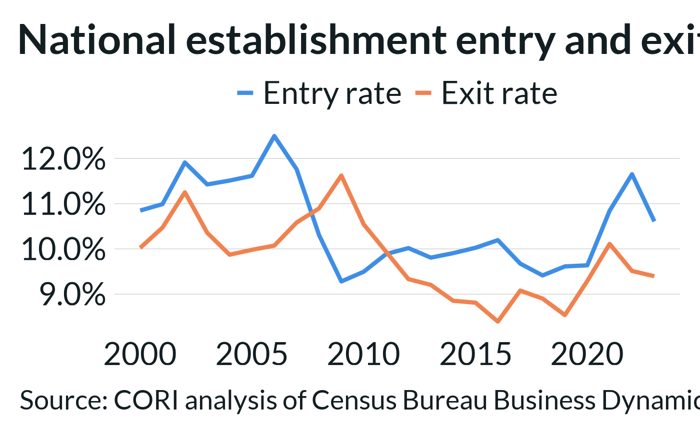

# Working with Tidy Data

``` r

library(cori.data.qcew)
library(cori.data.pep)
library(cori.data.bds)
library(cori.data.bfs)
library(cori.data.bps)
library(dplyr)
library(tidyr)
library(stringr)
```

The most powerful analyses in this ecosystem come from combining
packages — employment with population, business formation with building
permits, broadband with wages. What makes that combination frictionless
is a shared data contract: every function in every package returns the
same structure, with the same column names, at the same geographic
identifiers.

That structure is **tidy (long) format**. Once you know how to work with
it, joining any two packages takes three lines of code, filtering to a
geography or variable is a single
[`filter()`](https://dplyr.tidyverse.org/reference/filter.html), and
`ggplot2` accepts the output directly without reshaping. The patterns in
this vignette apply across the entire ecosystem — learn them once and
they work everywhere.

The format is always the same:

    geoid   year  variable           value
    33009   2023  employment         28450
    33009   2023  job_creation        4120
    33009   2022  employment         27810
    ...

One row per `geoid × year × variable`. This vignette walks through the
most common patterns for working with this format.

## Filtering by variable

The most common operation — selecting the measure you care about:

``` r

bd <- get_business_dynamics(geography = "county", years = 2018:2023)

# Single variable
estabs <- bd |> filter(variable == "establishments")

# Multiple variables
rates <- bd |> filter(variable %in% c("estab_entry_rate", "estab_exit_rate"))

# Pattern match — all rate variables
all_rates <- bd |> filter(str_ends(variable, "_rate"))
```

## Pivoting to wide format

When you need variables as columns — for correlation, regression,
joining with external data, or export to a spreadsheet:

``` r

bd_wide <- get_business_dynamics(geography = "county", years = 2022:2023) |>
  pivot_wider(names_from = variable, values_from = value)

# Now: geoid | year | establishments | estab_entries | estab_entry_rate | ...
glimpse(bd_wide)
#> Rows: 6,288
#> Columns: 9
#> $ geoid            <chr> "01001", "01001", "01003", "01003", "01005", "01005",…
#> $ year             <dbl> 2022, 2023, 2022, 2023, 2022, 2023, 2022, 2023, 2022,…
#> $ estab_entries    <dbl> 82, 67, 711, 626, 37, 26, 35, 26, 84, 84, 9, 10, 28, …
#> $ estab_entry_rate <dbl> 10.904, 8.679, 12.830, 10.904, 9.320, 6.607, 12.346, …
#> $ estab_exit_rate  <dbl> 8.777, 5.829, 8.662, 7.908, 8.312, 9.403, 8.466, 6.14…
#> $ estab_exits      <dbl> 66, 45, 480, 454, 33, 37, 24, 18, 51, 68, 10, 7, 21, …
#> $ establishments   <dbl> 760, 783, 5657, 5827, 399, 388, 289, 297, 708, 724, 1…
#> $ firm_deaths      <dbl> 46, 33, 327, 364, 20, 29, 16, 12, 40, 60, 7, 6, 12, 2…
#> $ firms            <dbl> 704, 727, 4875, 5000, 360, 351, 262, 269, 654, 660, 9…
```

The reverse — going from wide back to tidy — uses
[`pivot_longer()`](https://tidyr.tidyverse.org/reference/pivot_longer.html):

``` r

# If you receive data in wide format, bring it back to tidy
bd_tidy <- bd_wide |>
  pivot_longer(
    cols      = -c(geoid, year),
    names_to  = "variable",
    values_to = "value"
  )
```

## Joining across packages

Because every package returns the same `geoid + year` identifiers,
joining across packages is a simple
[`left_join()`](https://dplyr.tidyverse.org/reference/mutate-joins.html):

``` r

# Business applications + building permits — are they moving together?
apps <- get_business_applications(geography = "county", years = 2015:2023) |> 
  select(geoid, year, applications = value)

permits <- get_building_permits(geography = "county", years = 2015:2023) |>
  filter(variable == "building_permits") |>
  select(geoid, year, permits = value)

combined <- inner_join(apps, permits, by = c("geoid", "year"))

# Correlation between applications and permits
cor(combined$applications, combined$permits, use = "complete.obs")
#> [1] 0.7594486
```

You can join any number of packages the same way. Here’s a three-way
join bringing together employment, population, and business dynamics:

``` r

emp  <- get_employment(geography = "county", years = 2023) |>
  filter(variable == "employment") |>
  select(geoid, employment = value)

pop  <- get_population(geography = "county", years = 2023) |>
  filter(variable == "population") |>
  select(geoid, year, population = value)

estab <- get_business_dynamics(geography = "county", years = 2023) |>
  filter(variable == "establishments") |>
  select(geoid, establishments = value)

county_profile <- emp |>
  left_join(pop,   by = "geoid") |>
  left_join(estab, by = "geoid") |>
  mutate(
    emp_per_capita   = employment   / population,
    estab_per_capita = establishments / population
  )
```

## Filtering to specific geographies

Use `geoids` to pull specific counties or states — no filtering needed
after the fact:

``` r

# New England states (2-digit FIPS)
new_england <- c("09", "23", "25", "33", "44", "50")
ne_emp <- get_employment(geoids = new_england, years = 2018:2023)

# Appalachian counties (5-digit FIPS)
appalachian_counties <- c("54011", "54033", "21013", "21019", "47133")
app_bd <- get_business_dynamics(geoids = appalachian_counties, years = 2015:2023)
```

## Summarizing across geographies

With a rural classification joined in, aggregating to rural/nonrural or
state-level summaries is straightforward:

``` r

library(ruraldefinitions)

rural <- cbsa_2023 |> select(geoid, is_rural)

emp_summary <- get_employment(geography = "county", years = 2018:2023) |>
  filter(variable == "employment") |>
  left_join(rural, by = "geoid") |>
  filter(!is.na(is_rural)) |> 
  group_by(year, is_rural) |>
  summarize(
    total_employment = sum(value, na.rm = TRUE),
    n_counties       = n_distinct(geoid),
    .groups = "drop"
  )
```

## Using ggplot2 with tidy data

Tidy data maps directly to `ggplot2` aesthetics with no reshaping:

``` r

library(ggplot2)
# remotes::install_github('ruralinnovation/cori.charts')
library(cori.charts) ### CORI themed graphic package
load_fonts()

# Rate trends for two variables — one call, two lines
get_business_dynamics(geography = "nation", years = 2000:2023) |>
  filter(variable %in% c("estab_entry_rate", "estab_exit_rate")) |>
  ggplot(aes(x = year, y = value, color = variable)) +
  geom_line(linewidth = 1.5) +
  scale_color_cori(
    palette = "ctg2buor",
    labels  = c("estab_entry_rate" = "Entry rate", "estab_exit_rate" = "Exit rate")
  ) +
  scale_y_continuous(labels = scales::label_percent(accuracy = 0.1, scale = 1)) +
  theme_cori() +
  labs(
    title  = "National establishment entry and exit rates, 2000-2023",
    x      = NULL,
    y      = NULL,
    color  = NULL,
    caption = "Source: CORI analysis of Census Bureau Business Dynamics Statistics"
  )
```



## Data sources

> The Center on Rural Innovation’s curation of U.S. Census Bureau,
> *Business Dynamics Statistics*.
> <https://www.census.gov/programs-surveys/bds.html>
>
> The Center on Rural Innovation’s curation of U.S. Census Bureau,
> *Business Formation Statistics*.
> <https://www.census.gov/programs-surveys/bfs.html>
>
> The Center on Rural Innovation’s curation of U.S. Census Bureau, *New
> Residential Construction: Building Permits Survey*.
> <https://www.census.gov/construction/bps/>
>
> The Center on Rural Innovation’s curation of U.S. Bureau of Labor
> Statistics, *Quarterly Census of Employment and Wages*.
> <https://www.bls.gov/cew/>
>
> The Center on Rural Innovation’s curation of U.S. Census Bureau,
> *Population Estimates Program*.
> <https://www.census.gov/programs-surveys/popest.html>
>
> The Center on Rural Innovation’s curation of U.S. Census Bureau,
> *Metropolitan and Micropolitan Statistical Areas (OMB delineations)*.
> <https://www.census.gov/programs-surveys/metro-micro.html>
>
> This product uses the Census Bureau Data API but is not endorsed or
> certified by the Census Bureau. BLS.gov cannot vouch for the data or
> analyses derived from these data after the data have been retrieved
> from BLS.gov.
